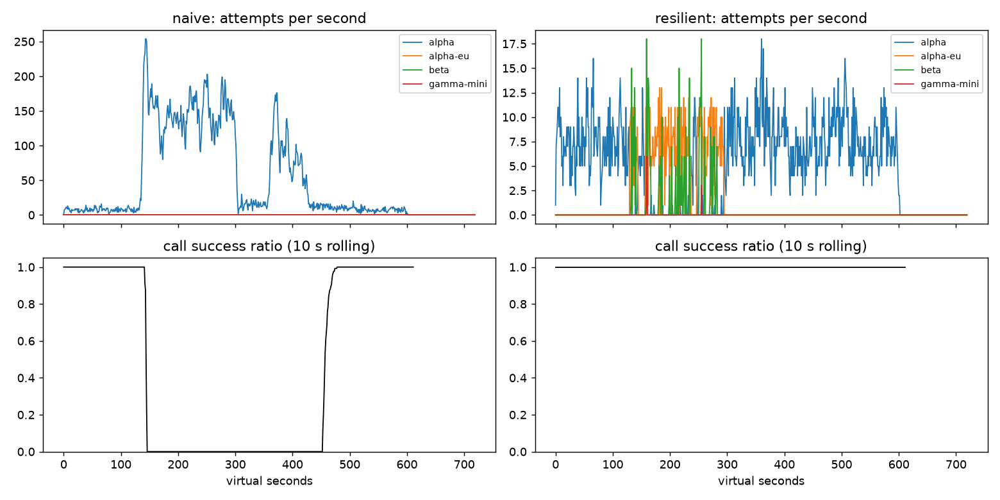

# Lab 25B — Report

**Họ tên / nhóm:** Lê Chí Hùng — MSV 2A202602863  **Commit:** _(điền hash)_  **Điểm tự động (`make grade`):** 84 / 88 (+4 SLO ẩn do giảng viên chấm)

> Số liệu: `reports/gameday/*.json`, `reports/cache/*.json`, `reports/workflows.json`, `reports/slo.json` (seed 25).
> Chạy lại mọi thí nghiệm: `python scripts/run_experiments.py`.

## 1. Kết quả Game Day

| Băng | Client | availability | p95 (s) | amplification | retry_ratio | cost/turn | recovery (s) | PASS? |
|---|---|---:|---:|---:|---:|---:|---:|:---:|
| G1 | naive | 0.7194 | 7.16 | 7.74 | 6.74 | 2.16 | 4 | ❌ |
| G1 | yours | 1.0000 | 4.82 | 1.06 | 0.001 | 2.09 | 0 | ✅ |
| G2 | naive | 0.4560 | 15.03 | 9.90 | 8.90 | 4.63 | 155 | ❌ |
| G2 | yours | 1.0000 | 10.78 | 1.04 | 0.005 | 2.12 | 0 | ✅ |
| G3 | naive | 1.0000 | 4.77 | 1.16 | 0.164 | 2.33 | 0 | ❌ |
| G3 | yours | 1.0000 | 4.72 | 1.07 | 0.035 | 2.15 | 0 | ✅ |
| G4 | naive | 1.0000 | 13.76 | 1.00 | 0.004 | 2.01 | 0 | ❌ |
| G4 | yours | 1.0000 | 5.68 | 1.01 | 0.002 | 2.07 | 0 | ✅ |
| G5 | naive | 0.3699 | 5.36 | 17.03 | 16.03 | 2.12 | – | ❌ |
| G5 | yours | 0.8179 | 5.48 | 1.00 | 0.002 | 2.50 | – | ✅ |
| G6 | naive | 0.5170 | 4.84 | 12.34 | 11.34 | 2.01 | 0 | ❌ |
| G6 | yours | 1.0000 | 6.23 | 1.07 | 0.027 | 2.16 | 0 | ✅ |

Kiểm tra độ bền: 6 băng × 5 biến thể × 10 seed = 300 lần chạy, **0 FAIL**. Biến thể gồm lệch thời điểm ±40 s và đổi cường độ ×0,8–1,3.

## 2. Cấu hình client

| Tham số | Giá trị | Vì sao |
|---|---:|---|
| attempt_timeout_s | 8 | Lớn hơn 2 lần p99 bình thường của beta (~4 s), và vẫn đủ thời gian failover trong deadline 30 s. G6: 8 s → avail 1,000; 30 s → 0,949 (FAIL). |
| max_attempts_per_provider | 2 | Cho 1 retry rồi failover. G2: giá trị 4 làm p95 tăng 10,8 → 11,7 s, vì call bị kẹt lâu ở provider đang quá tải. |
| backoff_base_s / cap_s | 0,25 / 4 | Jitter để khử đồng bộ retry. G2 với base 0,05 / 0,25 / 2 cho amplification 1,042 / 1,038 / 1,041, gần như không đổi. Gặp 429 thì luôn tôn trọng `retry_after` (G1: 0 vi phạm). |
| retry_budget_ratio | 0,1 | Lớp chặn cuối cùng. Khi breaker hỏng, G3 có retry 0,068 nếu có budget và 0,158 nếu không có. |
| window_size / min_calls | 20 / 10 | ≈ 2–3 s traffic của alpha. G3 với (100, 50): retry 0,068, vì breaker trip chậm hơn. |
| failure_rate_threshold | 0,5 | G3 (30% lỗi 500): không trip, nên vẫn dùng alpha và retry từng call (retry 0,035). Ngưỡng 0,9 cho retry 0,068. |
| slow_call_s | 5 | Thứ duy nhất bắt được G4. Tắt đi thì p95 13,8 s (FAIL); bật thì 5,7 s. |
| open_duration_s | 10 | G2 với 5 / 10 / 60 s: recovery đều 0. Giá trị 10 s cân bằng giữa việc không dội tải vào provider đang ốm và việc quay về primary nhanh. |
| half_open_max_probes | 2 | G2 với 1 / 2 / 20 probe: amplification 1,061 / 1,038 / 1,068. 20 probe tạo thundering herd. |

```
on_error: classify(err)
 CLIENT_ERROR     → breaker.release → GiveUp (không retry, không failover)
 QUOTA_EXHAUSTED  → breaker.release → cooldown 300 s → failover
 RATE_LIMITED     → breaker.release → cooldown tới retry_after → failover (hết ladder: chờ cooldown ≤ 5 s)
 OVERLOADED/500/TIMEOUT → breaker.on_failure
      tries < 2 & breaker không OPEN & còn budget & kịp deadline → retry cùng provider (jitter)
      còn lại → failover
ladder("tool") = alpha, alpha-eu, beta      ladder("chat") = + gamma-mini
```

## 3. Ba thí nghiệm

**1. Retry budget.** Cả 4 cấu hình dưới đây đều dùng `max_attempts_per_provider: 5`; "breaker hỏng" nghĩa là breaker không bao giờ trip.

| Băng | Cấu hình | ampl | retry_ratio | recovery | PASS |
|---|---|---:|---:|---:|:---:|
| G2 | breaker hỏng + budget | 1.378 | 0.058 | 0 | ✅ |
| G2 | breaker hỏng, không budget | 1.597 | 0.400 | 32 | ❌ |
| G3 | breaker hỏng + budget | 1.136 | 0.068 | 0 | ✅ |
| G3 | breaker hỏng, không budget | 1.162 | 0.158 | 0 | ❌ |
| G3 | breaker đúng, không budget | 1.036 | 0.020 | 0 | ✅ |

Khi breaker hoạt động đúng thì budget gần như không có tác dụng. Khi breaker sai, budget giữ retry ở mức ~10% tải và chặn được vòng lặp metastable. Nên giữ cả hai: breaker phản ứng theo sức khỏe từng provider, còn budget là giới hạn toàn cục.

**2. Timeout 30 s.** Ở G6, availability giảm 1,000 → 0,949 (106 call hết deadline), vì call bị treo ở alpha-eu đốt hết 30 s trước khi kịp failover. p95 lại giảm 6,2 → 5,4 s do survivorship bias. G4 không đổi (5,7 → 5,6 s) vì alpha vẫn trả lời trong ~6 s < 8 s, và thứ xử lý G4 là `slow_call_s`. Timeout đúng phải lớn hơn p99 lúc bình thường, nhưng đủ nhỏ để còn thời gian failover trong deadline của user.

**3. Bỏ lọc tool calling.** Ở G6: `incompatible_routes = 235`, availability còn 0,90. Nói theo ngôn ngữ product: 235 khách được một model không biết thao tác hệ thống trả lời rất tự tin, nhưng thực tế không có đơn nào được tra và không có tiền nào được hoàn. Ta vẫn mất tiền gọi model cho những câu trả lời đó.

## 4. Workflow hoàn tiền

| Executor | completion | crashes | dup refunds | dup emails | lost | overpaid (cents) | wasted LLM/crash |
|---|---:|---:|---:|---:|---:|---:|---:|
| naive | 1.000 | 81 | 128 | 81 | 0 | 1 496 700 | 1.123 |
| yours | 1.000 | 66 | 0 | 0 | 0 | 0 | 0.303 |

- **Chỉ có idempotency key:** không trả trùng tiền, nhưng worker mới phải chạy lại từ đầu, gây lãng phí LLM call.
- **Chỉ có checkpoint:** nếu crash sau khi tiền đã đi nhưng trước khi ghi checkpoint, worker mới sẽ trả lại lần nữa.
- **Ghi checkpoint trước khi gọi payment:** nếu crash ngay sau đó, store báo "đã hoàn" trong khi tiền chưa đi, gây **lost refund**.

## 5. Alerting & error budget

| Sự cố | Mong đợi | Naive | Burn-rate | Độ trễ phát hiện |
|---|---|---|---|---:|
| checkout_bug | page | page | page ✅ | 27 phút |
| provider_outage | page | page | page ✅ | 4 phút |
| deploy_blip | none | page ❌ | none ✅ | – |
| slow_leak | ticket | bỏ sót ❌ | ticket ✅ | 1 337 phút |
| degraded_evening | page | page | page ✅ | 291 phút |
| night_spike | none | page ❌ | none ✅ | – |
| small_bump | none | page ❌ | none ✅ | – |

Budget đã tiêu **42,95%**, còn **57,05%**, nên **không đóng băng release** (55 618 lỗi / 129 508,8 lỗi cho phép).

`small_bump` chỉ tiêu ≈ 1,1% budget. Burn rate cửa sổ 1h là 8 (< 14,4) và tự hết sau 20 phút, nên page lúc này chỉ gây alert fatigue.

## 6. Postmortem — G2, client naive



**Tóm tắt:** Ở t=120, alpha mất 75% GPU. Retry 3 tầng (tối đa 36 attempt/call, không jitter, không đọc retry-after) đẩy tải lên alpha từ 7,5 lên 150–250 attempt/s. Provider hồi phục ở t=300, nhưng hệ thống còn sập thêm 155 s.

**Ảnh hưởng:**
- 1 285 / 2 362 lượt thất bại (availability 45,6%).
- Tỷ lệ thành công bằng 0% trong khoảng t=145–450.
- Chi phí mỗi lượt thành công tăng ×2,2.
- Tiêu ≈ 2,5% error budget tháng (10,4 triệu lượt/tháng, budget 51 840 lượt).

**Timeline** (lấy từ `naive_G2_overload_storm_timeseries.csv`):

| t | Sự kiện | Số liệu |
|---:|---|---|
| 0–120 | Bình thường | alpha 7,5 att/s, thành công 895/895 |
| 120 | alpha mất 75% năng lực | 29 att/s, vẫn thành công 51/51 nhờ hàng đợi |
| 143 | Đỉnh retry storm | **254 att/s**; tỷ lệ thành công < 50% từ t=145 |
| 146–300 | Storm duy trì | 145–169 att/s, thành công **0/667**; 26 298 lỗi 429, 3 194 lỗi 529, 2 737 timeout |
| 300 | alpha hồi phục | vẫn 69 att/s, thành công 0/14 |
| 370 | Đợt retry thứ hai | 176 att/s, thành công 0/218 trong khoảng 370–420 |
| 456–470 | Hàng đợi rút | thành công 148/163 (91%); ≥ 95% từ t=470 |

**Trigger:** alpha mất GPU. **Root cause:** client có 3 tầng retry nhưng không có jitter, không có budget, không có breaker và không failover, nên khuếch đại tải lên ~10×.

**Vì sao không tự hồi phục sau t=300:** client timeout ở 8 s nhưng server vẫn xử lý request đã bị bỏ. Hàng đợi đầy việc vô ích. Retry vẫn đưa ~20 req/s vào hàng đợi, lớn hơn năng lực 15 req/s, nên request mới cũng timeout, sinh thêm retry. Vòng lặp chỉ dừng khi các call cạn attempt hoặc hết deadline.

**Action items:**

| # | Hành động | Loại | Owner | Kiểm chứng |
|---|---|---|---|---|
| 1 | Chỉ giữ 1 tầng retry (tắt retry ở gateway/SDK), dùng `ResilientClient` | prevent | LLM-gateway team | CI: G2 amplification ≤ 1,2, recovery ≤ 30 s |
| 2 | Circuit breaker + retry budget 10% + failover có lọc tool | mitigate | Agent runtime team | CI: 6/6 băng PASS trên 3 seed |
| 3 | Alert burn-rate + alert khi amplification > 2 trong 5 phút | detect | SRE on-call | Replay G2: page trong ≤ 5 phút sau t=120 |

## 7. Điểm yếu còn lại

p95 của G2 là 10,8 s: request phải chờ timeout 8 s mới failover. Hạ timeout xuống 4 s thì p95 còn 5,2 s, nhưng 4 s sát p99 của beta. Cách sửa: dùng timeout riêng cho từng provider (2–3 × p99) và hedged request có giới hạn bằng retry budget.

## 8. Cache (Part G)

| Client | availability | faq_avail | hit | stale | wrong | outdated | cost/turn | PASS? |
|---|---:|---:|---:|---:|---:|---:|---:|:---:|
| resilient (không cache) | 0.8373 | 0.8424 | 0.000 | 0 | 0 | 0 | 1.386 | ❌ |
| cached (của bạn) | 0.9124 | 0.9645 | 0.592 | 192 | 0 | 2 | 0.955 | ✅ |

| Tham số | Giá trị | Vì sao |
|---|---:|---|
| similarity_threshold | 0,92 | Paraphrase cùng intent có cosine ≈ 0,95–0,98; các intent gần mà khác ≈ 0,83–0,86. Ngưỡng 0,80 → 182 lỗi `other_question`; 0,97 → hit 0,495 (FAIL). |
| ttl_s | 30 | TTL 30 / 60 / 300 → outdated 2 / 3 / 95. Trong stress test, TTL 30 có 0 FAIL, còn TTL 45 FAIL 16 lần. |
| max_stale_s | 300 | Phải dài hơn đợt sập 120 s. Với 0 / 60 / 300 → faq_avail 0,853 / 0,918 / 0,965. |

**Thí nghiệm:**
- **Ngưỡng 0,80:** trả nhầm "thời gian hoàn tiền" thành "chính sách hoàn tiền", "ship tỉnh" thành "ship nội thành", "đổi màu" thành "đổi size".
- **TTL:** webhook chỉ xóa được những gì được báo. Phí ship đổi mà không báo trước thì chỉ TTL giới hạn được.
- **`max_stale_s: 0`:** faq_avail 0,965 → 0,853 (FAIL).

**Câu hỏi cá nhân:** câu của hai user khác nhau có cosine ≈ 0,99, nên cache dùng chung sẽ lộ đơn hàng của người khác. Cache riêng theo user cũng không ổn: dữ liệu đổi liên tục mà không có webhook, và hit ≈ 0.

**Alert khi đang phục vụ stale:** alert theo tỷ lệ `stale_served`, `GiveUp` của inner client và tỷ lệ thành công của provider, không theo availability phía user. Cache không được che sự cố khỏi on-call.
